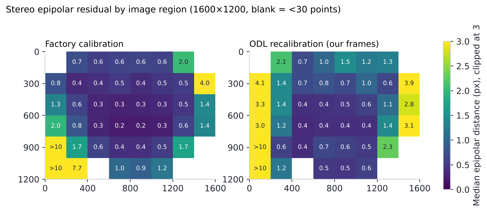
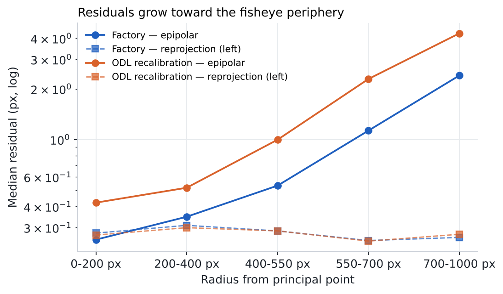

<!-- ODL_QUALITY_V2 -->

# Origin Data Lab · Technical Field Note #11

**ODL Fisheye Stereo Calibration Residuals**

[](https://github.com/origin-data-lab/fisheye-stereo-factory-calibration-independent-validation) [](https://huggingface.co/datasets/origin-data-lab/fisheye-stereo-factory-calibration-independent-validation) [](https://www.kaggle.com/datasets/origindatalab/odl-fisheye-stereo-calibration-residuals) [](https://origindatalab.io/technical-field-notes/fisheye-stereo-factory-calibration-independent-validation.html)

[English technical note](https://origindatalab.io/technical-field-notes/fisheye-stereo-factory-calibration-independent-validation.html) | [Korean technical note](https://origindatalab.io/ko/technical-field-notes/fisheye-stereo-factory-calibration-independent-validation.html)

---

# ODL Field Note #11 — Independent validation of a fisheye stereo factory calibration
Evaluate a stereo calibration on your own ChArUco recordings: per-corner reprojection residual (intrinsics fixed) and epipolar residual, summarised by image grid and radius.
```bash
pip install opencv-contrib-python-headless==4.10.0.84 numpy pandas pyyaml matplotlib
export ODL_DATA=analysis/data   # detection JSONs + your calibration yaml (Kalibr camchain format)
PYTHONPATH=analysis python3 analysis/a3_calib_validation.py out [recal.pkl]
```
Our factory file is not distributed. `a3_corner_residuals_factory.csv.gz` contains the per-corner results.
Licence: Creative Commons Attribution 4.0 International (CC BY 4.0) for derived data and figures; MIT for code.

## Visual evidence

Figures are taken from the released technical-note package. Interpret with the original methods and limitations.

### Figure 1



*Median epipolar residual per 200 px cell; left: factory calibration, right: our recalibration. Blank cells had fewer than 30 points.*

### Figure 2



*Median epipolar (solid) and reprojection (dashed) residuals by radius from the principal point.*


<!-- ODL_ENTITY_V1 -->
## About Origin Data Lab

**Origin Data Lab** (origindatalab.io, OriginDataLab Co., Ltd.) is a real-world data collection company based in **Yangyang, Gangwon State, South Korea**.
We plan and run egocentric, stereo+IMU and field video capture for physical AI and robotics teams, with documented QA such as the measurements in this dataset.
Not affiliated with "Origin Lab" (game data) or "OriginLab" (Origin/OriginPro software).

- **[Request sample data](https://origindatalab.io/contact.html?topic=sample&note=fn11&utm_source=github&utm_medium=referral&utm_campaign=field-notes)**: stereo+IMU or phone+IMU egocentric capture
- **[Custom data collection](https://origindatalab.io/data-services.html?utm_source=github&utm_medium=referral)**: field capture in South Korea and Bangladesh
- **[All technical field notes](https://origindatalab.io/technical-field-notes/?utm_source=github&utm_medium=referral)**

---

## Explore Origin Data Lab

[](https://github.com/origin-data-lab/fisheye-stereo-factory-calibration-independent-validation) [](https://huggingface.co/datasets/origin-data-lab/fisheye-stereo-factory-calibration-independent-validation) [](https://www.kaggle.com/datasets/origindatalab/odl-fisheye-stereo-calibration-residuals) [](https://origindatalab.io/technical-field-notes/fisheye-stereo-factory-calibration-independent-validation.html)

[Official Website](https://origindatalab.io/) | [Technical Field Notes](https://origindatalab.io/technical-field-notes/) | [English Note](https://origindatalab.io/technical-field-notes/fisheye-stereo-factory-calibration-independent-validation.html) | [Korean Note](https://origindatalab.io/ko/technical-field-notes/fisheye-stereo-factory-calibration-independent-validation.html)

[GitHub](https://github.com/origin-data-lab/fisheye-stereo-factory-calibration-independent-validation) | [Hugging Face](https://huggingface.co/datasets/origin-data-lab/fisheye-stereo-factory-calibration-independent-validation) | [Kaggle Dataset](https://www.kaggle.com/datasets/origindatalab/odl-fisheye-stereo-calibration-residuals) | [Kaggle Notebook](https://www.kaggle.com/code/origindatalab/odl-fisheye-stereo-calibration-residuals-notebook)


## Code availability

Device-specific readers and production pipeline code are withheld; see `CODE_AVAILABILITY.md`. Figures and result tables are complete.
